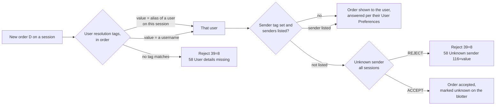

# Feature: Broker Settings (sell side)

Status: first cut built 2026-10-13. sofix-oems `e2615c6`; sofix-ui-be `c9b67cc`;
sofix-ui-fe `eb14d91`.

## 1. What the user does

Broker Settings (FIX Sessions menu, sell side only). Changing anything needs **Edit** on the panel,
which an administrator gives (Manage Rights); others see it read-only.

1. **Unknown sender (all sessions)**: **Reject (39=8)** or **Accept and mark**. Applies at once.
2. Pick a session (sessions with role Sell side), then:
   - **User resolution tags**: up to 5 tags, tried in order, e.g. `129` DeliverToSubID then `57`
     TargetSubID. Add, move up or down, remove.
   - **Accepted senders**: the **sender tag** (e.g. `116` OnBehalfOfSubID or `50` SenderSubID)
     and the values this session accepts, one per line. An empty list accepts everyone; an empty
     tag means no check.
   - **User aliases**: up to 3 per active user, e.g. the name the client's buy side uses for them.
     An alias belongs to one user per session; a clash is shown on the row.
3. **Save** (tags and senders, then aliases), **Discard**, or reload. Each change shows a success
   notice; a failure goes to the bell and the Error Log.

The Order Blotter has a **From** column: the order's sender, in amber with "unknown" when the
session does not list it.

## 2. How an order is attributed

- Aliases and usernames are compared trimmed and ignoring case. An alias counts only while its
  user is active, i.e. among the users sofix-ui-be sends to the OEMS.
- A session without Broker Settings uses its identity tag from Session Business Configuration
  (default 116) and checks no senders. That field is no longer edited in the UI.
- The sender is the value of the sender tag (116 when none is set) and is stored on the order.
- Example: the buy side sends `116=john` (its trader) and `129=m.smith`. Set the tags to 129, 57,
  the sender tag to 116 with `john` accepted, and the alias `M.Smith` for Mary. The order is
  Mary's, and it comes from john.

## 3. Data

| Data | Where |
|---|---|
| A session's tags, sender tag, accepted senders | sell OEMS DB, `broker_session_setting` (V11) |
| Aliases | sell OEMS DB, `broker_user_alias` (session, alias, user id, username, position) |
| Unknown sender action | sell OEMS DB, `broker_global_setting` (one row; REJECT when none) |
| Users offered for aliases | UI DB, `app_user` (active), via backend `GET /api/broker-settings/users` |
| Order's sender | in memory on the order; sent to the blotter as `sender`, `senderUnknown` |
| Endpoints | backend `/api/broker-settings` (GET), `/sessions/{id}`, `/sessions/{id}/aliases`, `/global` (PUT) → OEMS |

The OEMS keeps the settings in memory, reloads them after every change and when an order arrives on
a session it does not know yet. No restart is needed.

## 4. Enforced and tested

| Rule | Where | Test |
|---|---|---|
| 1–5 tags, 1–99999, not a header tag, no duplicates, not the sender tag; at most 200 senders and 3 aliases; values ≤ 64 characters; one user per alias (OEMS-CFG-0006) | `BrokerSettingsValidator` | `BrokerSettingsValidatorTest`, `BrokerSettingsApiTest` |
| First matching tag wins; alias or username; inactive alias ignored; unknown sender reject or mark | `BrokerSettingsService.attribute` | `BrokerSettingsServiceTest` |
| Read needs View, change needs Edit on Broker Settings; sell side only | backend `permissions.js`, `SIDE_ROUTES` | manual check 2026-10-13 |
| Whole flow over FIX: alias via 129, unknown sender rejected then accepted and marked, no user rejected; panel save and clash; From column | throwaway sell stack | manual check 2026-10-13 |

## 5. Known limitations

1. Cancels and replaces (F, G) are matched to the original order and keep its user. The sender of
   the cancel or replace is not checked again.
2. The sender check uses one tag per session. A sender list per user is not built.
3. Aliases of a user who is made inactive stay stored and are shown as "Not active". They no longer
   match.
4. No history of changes beyond who saved last and when (and the OEMS audit log).
5. The buy side has no Broker Settings; its user identity tag stays in its Session Business
   Configuration.
