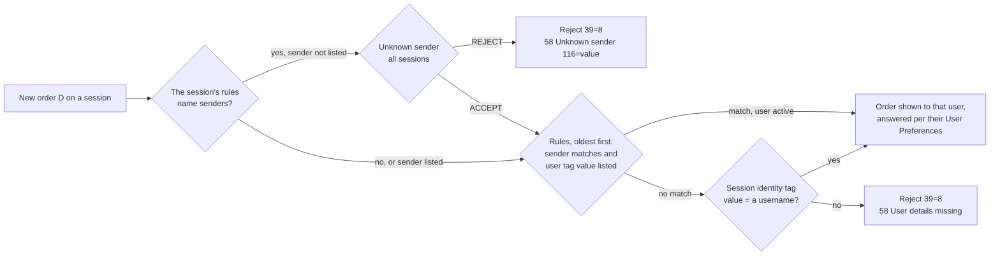

# Feature: Broker Settings (sell side)

Status: built 2026-10-13, reworked the same day into rules. sofix-oems `54885d9` `15a2d06`;
sofix-ui-be `a0ecf78`; sofix-ui-fe `8872b89` (blotter From column `eb14d91`).

## 1. What the user does

Open Broker Settings from the FIX Sessions menu (sell side only). It shows a table of rules:

| Inbound Session | Sender: Tag | Sender: Values | Mapped to User Using: Tag | Mapped to User Using: Values | Mapped to User |
|---|---|---|---|---|---|
| Apex Capital (APEX) | 116 | john, anna | 129 | m.smith, mary.s | mary |
| Apex Capital (APEX) | 116 | john | 129 | j.doe | jdoe |

- **Add Rule**, **Edit** and **Delete** are in the panel header. A double-click on a row also edits
  it. Adding or editing opens a dialog with these fields:
  - the inbound session;
  - the sender: a tag and its comma-separated values, optional (empty means any sender);
  - the user tag and its comma-separated values (1 to 3);
  - the user.
- The table can be filtered by session and searched.
- **Unknown sender (all sessions)** sits above the table: **Reject (39=8)** or **Accept and mark**.
- Changing anything needs **Edit** on the panel, which an administrator gives in Manage Rights.
  Without it, the panel is view only.
- Each change shows a success notice. A failure goes to the bell and the Error Log. The OEMS's
  reason is also shown on the dialog's field.
- The Order Blotter's **From** column shows the order's sender. A sender no rule of its session
  lists is shown in amber with "unknown".

A session can have rules for many users. Each order goes to the user whose rule matches its tag
value.

## 2. How an order is attributed

- Values are compared trimmed and ignoring case. A rule counts only while its user is active,
  i.e. among the users sofix-ui-be sends to the OEMS.
- A sender is unknown when the session has rules with senders and the order's sender matches none
  of them. The shown sender is the value of the first such rule's sender tag (116 when there is
  none).
- If no rule matches, the identity tag of Session Business Configuration (default 116) is looked up
  among the usernames, as before Broker Settings.
- A value of a user tag can be mapped by only one rule per session for the same sender (the
  OEMS refuses a second one, also for the same user).

## 3. Data

| Data | Where |
|---|---|
| Rules | sell OEMS DB, `broker_rule` (V12): session, sender tag, sender values, user tag, user values (JSON), user id, username |
| Unknown sender action | sell OEMS DB, `broker_global_setting` (V11, one row; REJECT when none) |
| Users offered in the dialog | UI DB, `app_user` (active), via backend `GET /api/broker-settings/users` |
| Order's sender | in memory on the order; sent to the blotter as `sender`, `senderUnknown` |
| Endpoints | backend `/api/broker-settings` (GET), `/rules` (POST), `/rules/{id}` (PUT, DELETE), `/global` (PUT) → OEMS |

The OEMS keeps the rules in memory. It reloads them after every change, and when an order arrives
on a session it does not know yet. No restart is needed. V12 replaced the V11 tables
`broker_session_setting` and `broker_user_alias`, which existed for a few hours on 2026-10-13.

## 4. Enforced and tested

| Rule | Where | Test |
|---|---|---|
| Tags 1–99999 and not header tags; sender values need a sender tag; user tag ≠ sender tag; 1–3 user values; at most 200 sender values; values ≤ 64 characters, no duplicates; a user; one rule per value and sender (OEMS-CFG-0006); unknown rule (OEMS-CFG-0007, 404) | `BrokerSettingsValidator`, `BrokerSettingsService` | `BrokerSettingsValidatorTest`, `BrokerSettingsServiceTest`, `BrokerSettingsApiTest` |
| Several users on one session; first matching rule; inactive user ignored; username fallback; unknown sender reject or mark | `BrokerSettingsService.attribute`, `BrokerRule.matches` | `BrokerSettingsServiceTest` |
| Read needs View, change needs Edit on Broker Settings; sell side only | backend `permissions.js`, `SIDE_ROUTES` | manual check 2026-10-13 |
| Whole flow over FIX and in the browser: - dialog add and refused clash - double-click edit, delete with confirmation - 129=mary.s → mary and 129=j.doe → jdoe on one session - unknown sender rejected; From column | throwaway sell stack | manual check 2026-10-13 |

## 5. Known limitations

1. Cancels and replaces (F, G) are matched to the original order and keep its user. Their sender
   is not checked again.
2. Rules cannot be reordered; the oldest matching rule wins. Clashing rules are refused, so the
   order only matters when a rule with no sender and one with a sender both match.
3. A rule of a user who is made inactive stays in the table and no longer matches.
4. There is no history of changes beyond who saved a rule last and when, plus the OEMS audit log.
5. The buy side has no Broker Settings. Its user identity tag stays in its Session Business
   Configuration.
