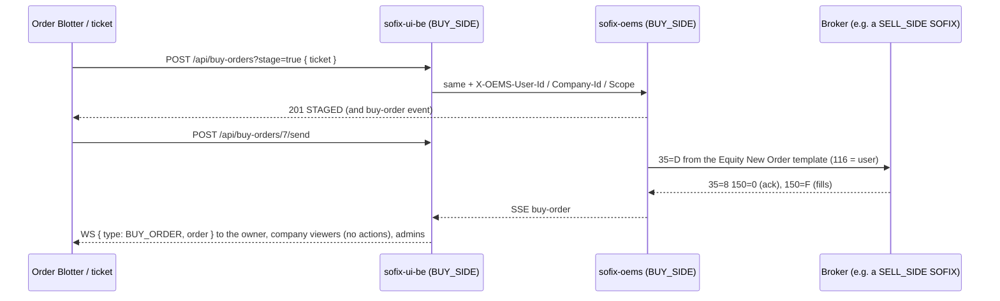

# Feature: buy-side order entry (Create Order, staging, send, replace, cancel)

Status: built 2026-10-12, asset classes and session templates 2026-10-13. sofix-oems `ccbc6f5`
`dca51b5` `b796766` `076eae6` `afbaa78` `f285bc6`; sofix-ui-be `bf18279` `6207a38`; sofix-ui-fe
`854cc0a` `64daedd` `eeb8f55` `f9e46d1`. Design: `docs/design/buy-side-message-templates.md`.

## 1. What the user does

1. Buy side (`DEPLOYMENT_MODE=BUY_SIDE`): the app opens on the **Order Blotter**.
2. **Create Order** → Order Entry, one tab per asset class: **Equity**, **Option** (underlying,
   Maturity 200, Strike 202, Put/Call 201, Open/Close 77), **Multi-leg Option** (35=AB: net
   price, a legs grid: symbol, maturity, strike, put/call, side, ratio, open/close) and
   **Future** (Maturity 200). Which fields a tab shows, which are required, their defaults and
   values come from that asset class's New Order template on the chosen session. **Stage on
   Blotter** keeps it unsent; **Submit Order** sends it now.
3. Right-click an order: staged → **Send / Edit / Delete**; working → **Replace** (only quantity,
   type, prices, TIF, expire time, comments) / **Cancel Order**.
4. The row follows the broker's answers live (Pending New → New → Partially Filled → Filled;
   Replace / Cancel pending; Canceled; Rejected with the reason).
5. Click an order: **Order Lifecycle** shows its steps (Staged → Sent → Acknowledged → Filling →
   Done), its replaces and cancels with the broker's answer, and every message; click a message:
   **Message Details** shows it tag by tag. Double-click or the context menu opens them.
6. **Session Business Configuration** (buy side): a session's templates per asset class and
   message (New Order, Replace, Cancel), tag by tag. Users with Edit on the panel (given by an
   administrator) change defaults and fixed values, make tags required or amendable, leave
   optional ticket tags out, add custom fixed tags, or reset to the built-in template. The next
   message on that session uses the change.

## 2. Flow

## 3. Data and ownership

| Data | Where |
|---|---|
| Orders, their events and messages | OEMS memory (`BuyOrderBook`); owner user id, username, company id on each |
| Built-in templates (Equity, Option, Multi-leg Option, Future: D/AB, G/AC, F) | OEMS code (`DefaultBuyTemplates`) |
| A session's changed templates | OEMS database, `buy_session_template` (V7), held in memory |
| The ticket's templates | `GET /api/order-templates?sessionId=` (per asset class) |
| Who sees what | Viewer from the backend: own / company / all (same as test suites) |

## 4. Enforced and tested

| Rule | Where | Test |
|---|---|---|
| Ticket rules by field | `TicketValidator` | `BuyOrderBookTest` |
| Messages from templates (locked, carried, ticket, fixed) | `OutboundMessages`, `BuyOrderBook` | `BuyOrderBookTest` |
| Actions by state, state before session | `BuyOrderAction`, `BuyOrderService` | `BuyOrderApiTest` |
| Visibility / act rights | `Viewer`, backend relay `buyOrderReach` | `BuyOrderApiTest`, backend throwaway check |
| Template edits (locked, required, custom tags) | `TemplateEdits`, `BuyTemplateService` | `TemplateEditsTest`, `BuyOrderApiTest` |
| Lifecycle steps and requests | `BuyOrderLifecycle` | `BuyOrderBookTest` |
| Legs in 555, FIX 4.4 order | `OutboundMessages`, `FixMessageConverter` | `BuyOrderBookTest`, `FixMessageConverterTest` |
| Whole flow over FIX | two OEMS instances + backend + browser | manual checks 2026-10-12 and 2026-10-13 (option: ack, fill, replace; templates edit) |

## 5. Known limitations

1. Orders live in memory: an OEMS restart loses them (persistence is Phase D of the order work).
2. Multi-leg orders (35=AB / AC) need a broker that takes them: SOFIX's own sell side answers
   "Unsupported Message Type" (it handles 35=D / G / F), and the buy side does not yet turn that
   session-level reject into a Rejected order (it stays Pending New). Leg put/call is sent as
   LegCFICode (608: OC / OP) for FIX 4.4; LegPutOrCall (1358) is FIX 5.0.
3. Template editing changes values, flags and custom fixed tags; it cannot add ticket fields,
   change value lists or tag numbers. Templates are per session, not yet per profile.
4. No pre-trade checks (max quantity, price collar…), no order presets, no ATDL strategies.
5. The user's identity goes in 116 always (the session's identity tag setting is sell side).
6. The simulator's FIX Message Templates (certification) are separate from these templates, by
   decision (2026-10-12).
