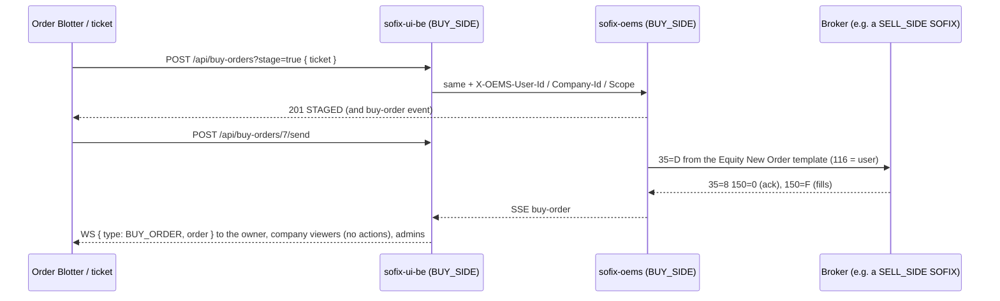

# Feature: buy-side order entry (Create Order, staging, send, replace, cancel)

Status: built 2026-10-12. sofix-oems `ccbc6f5` `dca51b5` `b796766` (+ `4d16995` shared Viewer);
sofix-ui-be `bf18279`; sofix-ui-fe `854cc0a`. Design: `docs/design/buy-side-message-templates.md`.

## 1. What the user does

1. Buy side (`DEPLOYMENT_MODE=BUY_SIDE`): the app opens on the **Order Blotter**.
2. **Create Order** → Order Entry (Equity): Target Session, Symbol, Side, Quantity, Order Type,
   Limit / Stop Price, Time in Force (Expire Time for GTD), Account, Destination (100), Currency
   (15), Comments (58). **Stage on Blotter** keeps it unsent; **Submit Order** sends it now.
3. Right-click an order: staged → **Send / Edit / Delete**; working → **Replace** (only quantity,
   type, prices, TIF, expire time, comments) / **Cancel Order**.
4. The row follows the broker's answers live (Pending New → New → Partially Filled → Filled;
   Replace / Cancel pending; Canceled; Rejected with the reason).

## 2. Flow

## 3. Data and ownership

| Data | Where |
|---|---|
| Orders, their events and messages | OEMS memory (`BuyOrderBook`); owner user id, username, company id on each |
| Templates (Equity D / G / F) | OEMS code (`EquityTemplates`), served at `/api/order-templates` |
| Who sees what | Viewer from the backend: own / company / all (same as test suites) |

## 4. Enforced and tested

| Rule | Where | Test |
|---|---|---|
| Ticket rules by field | `TicketValidator` | `BuyOrderBookTest` |
| Messages from templates (locked, carried, ticket, fixed) | `OutboundMessages`, `BuyOrderBook` | `BuyOrderBookTest` |
| Actions by state, state before session | `BuyOrderAction`, `BuyOrderService` | `BuyOrderApiTest` |
| Visibility / act rights | `Viewer`, backend relay `buyOrderReach` | `BuyOrderApiTest`, backend throwaway check |
| Whole flow over FIX | two OEMS instances + backend + browser | manual checks 2026-10-12 |

## 5. Known limitations

1. Orders live in memory: an OEMS restart loses them (persistence is Phase D of the order work).
2. Equity only; the other asset-class tabs are placeholders; templates are not editable yet.
3. No pre-trade checks (max quantity, price collar…), no order presets.
4. Order Lifecycle and Message Details are sell-side panels for now.
5. The user's identity goes in 116 always (the session's identity tag setting is sell side).
6. The simulator's FIX Message Templates (certification) are separate from these templates, by
   decision (2026-10-12).
