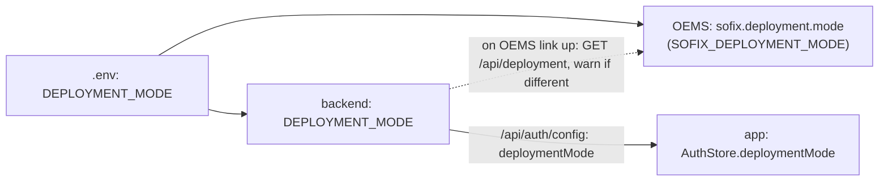

# Feature: deployment modes (SELL_SIDE / BUY_SIDE) and the side-separated code

Status: built 2026-10-12; side tables updated 2026-11-12 for what was added since (buy-side
orders, companies, Broker Settings, ER templates). Decision:
`docs/design/application-scope-and-tenancy.md` §7.

## 1. What it is

One codebase, deployed as either side of the market. One setting decides which:

| | SELL_SIDE (default) | BUY_SIDE |
|---|---|---|
| Who | A broker: receives client orders, answers with ExecutionReports | Buy-side companies: send orders to brokers |
| Main panel (first layout) | Order Blotter (orders received, `order-blotter`) | Order Blotter (orders sent, `buy-order-blotter`) |
| Side-only panels (`PANEL_SIDES`) | Order Blotter, Broker Settings | Order Blotter, Companies, Buy-Side Simulator, Executable Test Cases, Test Case Result, FIX Message Template |
| Side-only API (OEMS) | `/api/orders` (actions, lifecycle, messages), `/api/sessions/{id}/business-config`, `/api/sessions/{id}/report-templates`, `/api/broker-settings`, `/api/users/{id}/preferences` and test runs | `/api/buy-orders` (stage, send, replace, cancel, lifecycle, messages), `/api/order-templates`, `/api/buy-session-templates/…`, `/api/certification-results` (called by the sell-side OEMS) |
| Side-only API (backend, `SIDE_ROUTES`) | business settings, report templates, Broker Settings, broker actions on orders, `/api/preferences` | `/api/buy-orders`, `/api/order-templates`, `/api/buy-session-templates/…`, `/api/templates`, `/api/test-runs`, `/api/companies` |

Everything else (sessions, Replay Tool, users and access, certification specifications and test
cases, test suites, Order Lifecycle, Message Details, Security Master, contacts, Error Log) is
common. Session Business Configuration exists on both sides with different contents (sell:
identity tag, Test result URL and key, ER templates; buy: identity tag, result access key,
message templates). Run both sides as two stacks
(`docs/deployment/docker.md` 2.6).

## 2. The setting and how it flows

| Where | How the mode acts |
|---|---|
| OEMS | `DeploymentMode` bean; beans annotated `@OnDeploymentMode(SELL_SIDE)` (controllers, order / business-config / preferences wiring) exist only in that mode; elsewhere their paths answer 404 OEMS-GEN-0002. Logged at start and in the banner |
| Backend | `SIDE_ROUTES` in `server.js`: the other side's routes answer 404 "Not available in a … deployment". An unknown value stops the backend at start |
| App | `PANEL_SIDES` (`shell/panel-sides.ts`); `AccessStore.accessTo` hides other-side panels from everyone, so menu, quick open and restored layouts follow; the first layout opens the side's main panel |

## 3. Code layout (how to tell common from side code)

| Repo | Common | Sell side | Buy side | Enforced by |
|---|---|---|---|---|
| sofix-oems | `com.sosuv.oems.<layer>.common.<feature>`, `fix.qfj`, `app` | `com.sosuv.oems.<layer>.sellside.<feature>` | `com.sosuv.oems.<layer>.buyside.<feature>` | ArchUnit (`ArchitectureTest`): common and the FIX adapter never use a side; the sides never use each other |
| sofix-ui-be | `src/common/` | `src/sell-side/` | `src/buy-side/` | convention (README) |
| sofix-ui-fe | everything outside the two side folders | `src/app/sell-side/` | `src/app/buy-side/` | convention + grep check (frontend architecture doc); only `panel-registry.ts` and `provide-backend.ts` wire both |

## 4. Tests

* OEMS: `DeploymentModeApiTest` (BUY_SIDE: mode reported, sell-side endpoints 404), the other API
  tests run SELL_SIDE; `FixSessionApiTest.anUnknownPathIs404AndAWrongMethod405`; ArchUnit rules.
* Backend and app: throwaway backend in each mode (routes, default tabs, menu) on 2026-10-12.

## 5. Known limitations

1. Each side's OEMS ignores the other side's messages: a SELL_SIDE OEMS only logs received
   ExecutionReports (no street side), a BUY_SIDE OEMS only logs received orders.
2. The backend and app separation is by convention, not checked by a build tool.
3. The Buy-Side Simulator's test runs (`/api/test-runs`) answer 503 since the Mock Engine was
   retired; buy-side orders go through the Buy Order Blotter and the OEMS instead.
4. Manage Rights still lists the other side's panels when assigning rights (harmless: they never
   show).
5. Both stacks must use the same `DEPLOYMENT_MODE` for their OEMS and backend; a difference is
   only logged as a warning.
6. Every OEMS database gets both sides' tables (one set of migrations); the other side's stay
   empty.
7. Orders are kept in memory on both sides (lost on restart).
