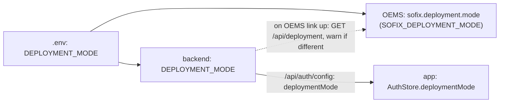

# Feature: deployment modes (SELL_SIDE / BUY_SIDE) and the side-separated code

Status: built 2026-10-12. Decision: `docs/design/application-scope-and-tenancy.md` §7.

## 1. What it is

One codebase, deployed as either side of the market. One setting decides which:

| | SELL_SIDE (default) | BUY_SIDE |
|---|---|---|
| Who | A broker: receives client orders, answers with ExecutionReports | Buy-side companies: send orders to brokers |
| Main panel | Order Blotter | Buy-Side Simulator |
| Side-only panels | Order Blotter, Session Business Configuration | Buy-Side Simulator, Executable Test Cases, Test Case Result, FIX Message Template |
| Side-only API (OEMS) | `/api/orders` (and actions, lifecycle, messages), `/api/sessions/{id}/business-config`, `/api/users/{id}/preferences`, test runs of incoming orders | (to come: test suites, sending test cases, results) |
| Side-only API (backend) | business settings, broker actions on orders | templates, test runs |

Everything else (sessions, users and access, certification, Order Lifecycle, Message Details,
Security Master, contacts, Error Log) is common. Run both sides as two stacks
(`docs/deployment/docker.md` 2.6).

## 2. The setting and how it flows

| Where | How the mode acts |
|---|---|
| OEMS | `DeploymentMode` bean; beans annotated `@OnDeploymentMode(SELL_SIDE)` (controllers, order / business-config / preferences wiring) exist only in that mode; elsewhere their paths answer 404 OEMS-GEN-0002. Logged at start and in the banner |
| Backend | `SIDE_ROUTES` in `server.js`: the other side's routes answer 404 "Not available in a … deployment". An unknown value stops the backend at start |
| App | `PANEL_SIDES` (`shell/panel-sides.ts`); `AccessStore.accessTo` hides other-side panels from everyone, so menu, quick open and restored layouts follow; the first layout opens the side's main panel |

## 3. Code layout (how to tell common from side code)

| Repo | Common | Sell side | Buy side | Enforced by |
|---|---|---|---|---|
| sofix-oems | `com.sosuv.oems.<layer>.common.<feature>`, `fix.qfj`, `app` | `com.sosuv.oems.<layer>.sellside.<feature>` | `com.sosuv.oems.<layer>.buyside.<feature>` | ArchUnit (`ArchitectureTest`): common and the FIX adapter never use a side; the sides never use each other |
| sofix-ui-be | `src/common/` | `src/sell-side/` | `src/buy-side/` | convention (README) |
| sofix-ui-fe | everything outside the two side folders | `src/app/sell-side/` | `src/app/buy-side/` | convention + grep check (frontend architecture doc); only `panel-registry.ts` and `provide-backend.ts` wire both |

## 4. Tests

* OEMS: `DeploymentModeApiTest` (BUY_SIDE: mode reported, sell-side endpoints 404), the other API
  tests run SELL_SIDE; `FixSessionApiTest.anUnknownPathIs404AndAWrongMethod405`; ArchUnit rules.
* Backend and app: throwaway backend in each mode (routes, default tabs, menu) on 2026-10-12.

## 5. Known limitations

1. In BUY_SIDE the OEMS has no order handling yet: an incoming ER or order is logged and dropped
   (the buy-side order and test-case handling is the next work).
2. The backend and app separation is by convention, not checked by a build tool.
3. The Buy-Side Simulator puts the username in tag 116; a buy-side setting for the tag is not
   built (it used to read the sell-side identity tag).
4. Manage Rights still lists the other side's panels when assigning rights (harmless: they never
   show).
5. Both stacks must use the same `DEPLOYMENT_MODE` for their OEMS and backend; a difference is
   only logged as a warning.
