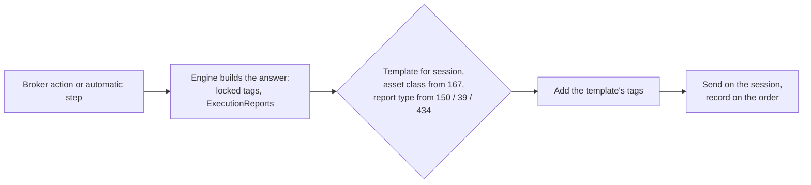

# Feature: ExecutionReport templates (sell side)

Status: first cut built 2026-10-13. sofix-oems `b87366c` `86f5301`; sofix-ui-be `44f28f9`;
sofix-ui-fe `2feadc3`. Design: `docs/design/execution-report-templates.md` (§1–6, §9).

## 1. What the user does

Session Business Configuration → pick a sell-side session → **ExecutionReport templates**
(Edit right on the panel, given by an administrator, to change them):

1. Choose the asset class: **Default** (every order), **Equity**, **Option**, **Future**.
2. Choose the report type: Pending New, Ack, Reject, Partial Fill, Fill, Pending Cancel, Canceled,
   Pending Replace, Replaced, Cancel Reject, Replace Reject, Done For Day, Expired.
3. For the pending reports only: **Sent** on / off. A switched-off report is not offered as a
   broker action and an automatic lifecycle skips it.
4. Add tags: **Echo from order** (the client's value of that tag), **Constant**, or
   **Expression**: `$now` (UTC timestamp), `$tradeDate` (YYYYMMDD), `$unique` / `$unique(n)`
   (random id, 4–32 characters), `$order.tag(n)` (tag n of the client's order).
5. **Save Template**, **Discard**, or **Reset** (back to Default's / built in). The status shows
   whether the template is the session's own, Default's, or built in. The locked tags (set by the
   engine) are listed under "Locked".

## 2. How an answer is built

Which template applies (first match): the session's own for the order's asset class; else the
asset class's built-in tags plus the session's own **Default** template (its Sent flag and its
tags); else the built-in one. Built in: everything sent, nothing added for Default and Equity;
options echo 167, 200, 201, 202, 77; futures echo 167, 200.

## 3. Data

| Data | Where |
|---|---|
| A session's changed templates | sell OEMS DB, `sell_report_template` (V10): session, asset class, report type, enabled, tags (JSON) |
| Built-in templates, locked tags | OEMS code (`BuiltInReportTemplates`, `LockedReportTags`) |
| Endpoints | backend `/api/sessions/{id}/report-templates[/{class}/{type}]` → OEMS (GET list, PUT change, DELETE reset) |

Templates are read once per session and held in memory; changes apply to the next answer.

## 4. Enforced and tested

| Rule | Where | Test |
|---|---|---|
| Mandatory reports cannot be switched off; locked and header tags cannot be added; no duplicates; constants 1–200 characters; known expressions only; at most 30 tags | `ReportTemplates.validate` (OEMS-CFG-0005) | `ReportTemplatesTest`, `ReportTemplateApiTest` |
| Report type of each answer | `ReportType.of` | `ReportTemplatesTest` |
| Tags added on send; echo of a tag the order lacks is left out | `ReportTemplates.apply`, `OrderService.send` | `ReportTemplatesTest`, `OrderServiceTest` |
| Switched-off pending report: not offered, refused (OEMS-ORD-0002), skipped by auto | `OrderService.actionsOf` | `OrderServiceTest` |
| Fallback: own → built-in + Default → built-in | `ReportTemplateService` | `ReportTemplateApiTest` |
| Editor in the browser (add, refuse locked 37, save, option inherits) | throwaway sell stack | manual check 2026-10-13 |

## 5. Known limitations

1. **Trader input** tags (e.g. 30 LastMkt typed in the Fill dialog) are not built yet: the action
   dialogs still ask only for quantity, price and text.
2. No template profiles, versions, preview of the full message, or per-FIX-version built-ins;
   templates are per session.
3. Tag numbers are not checked against the session's FIX dictionary.
4. `$unique` ids are random, not counted per session and day; `$seq`, `$session.*`, `$input.*`
   and the string helpers of the design are not built.
5. Multileg and fixed income asset classes are not separate (their orders use Equity / Default).
6. The automation policy per asset class (§9) is not built; Manual / Auto stays per user (User
   Preferences).
