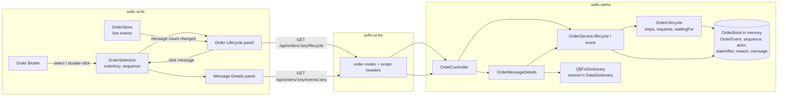
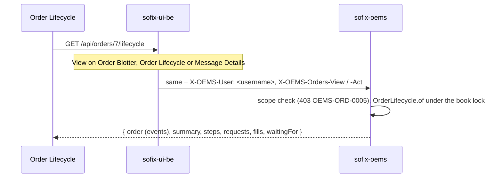

# Feature: Order Lifecycle and Message Details (Phase A)

Status: built 2026-10-11. Phase A of `docs/design/order-lifecycle-and-persistence.md` (§6, the
lifecycle view), on the orders the OEMS keeps in memory. Later phases: B identifiers and duplicates
(§1–3), C busts and corrections (§5), D PostgreSQL storage (§6), E time in force (§7), F crash
recovery (§7b), G street side (§6).

Commits: sofix-oems `4addeec` `6545ccc` `4332841`; sofix-ui-be `9d4863e` `7fb81c1` `e3ef0c7`
`f0deb92`; sofix-ui-fe `b8a7f41` `b5f5aee` `13d4bf2` `be52955`.

## 1. What the user sees

| Panel | Shows | Opened by |
|---|---|---|
| **Order Lifecycle** | Summary (side, qty, symbol, price, state, 11 and first 11, 37, session, user); **smart progress**: 1 Received → 2 Pending New (only if sent) → 3 Acknowledged / Rejected → 4 Filling (fill bar, `cum / qty filled · n fills · avg px`) → 5 Done (Filled / Canceled / Rejected, or "Open: n left"); **Waiting for** (Ack or Reject / an answer to the client's amend or cancel / fills); **Amends and cancels** with outcome (Waiting, Pending sent, Accepted, Rejected + reason); the **message timeline** in event order | Double-click an order on the blotter, or its right-click menu |
| **Message Details** | One message as a table: **Tag**, **Tag Name**, **Tag Value** (with meaning, e.g. `1 (Buy)`), **Required** (Required / Optional / Not in dictionary / **Missing**), Section; the actor, session, state after and a reject's reason; a picker for any message of the order | Click a step, request or message in Order Lifecycle (double-click opens it), or the blotter's right-click menu |

Both follow the order selected on the blotter (`OrderSelection`) and update as its messages arrive.

## 2. Components and data

| Data | Where | Notes |
|---|---|---|
| Order events (every message in and out) | OEMS memory, `Order.events` | `sequence` (order of events; times can tie), `actor` CLIENT / TRADER / AUTO / SYSTEM + username, `stateAfter`, `reason` (58 of a reject). The in-memory form of the design's `order_event` |
| Progress, requests, waiting-for | computed on each request | `OrderLifecycle.of(order)` in oems-domain; nothing stored |
| Field names, meanings, required | the session's QuickFIX/J data dictionary | Running session's own (standard or uploaded; FIXT: application dictionary of its default ApplVerID); else the standard one for the message's 8; `sofix.extensions.fix-dictionary=plain` turns it off |
| Selected order and message | browser, `OrderSelection` | shared by the three panels; not saved |

## 3. Data flows

### 3.1 Opening the lifecycle

### 3.2 Live updates

A new message of the order arrives as a live `order` event (filtered by scope, see
`order-visibility.md`) → `OrderStore` adds it → the selected order's message count changes → Order
Lifecycle fetches the lifecycle again. Message Details follows the newest message unless one was
picked.

### 3.3 Message Details

`GET /api/orders/7/events/12` → `OrderService.event` (scope check, 404 for an unknown message) →
`QfjFixDictionary.describe(sessionId, message)` outside the order lock → fields in order, then
required body fields the message lacks (`present: false`).

### 3.4 Who is the actor

| Event | Actor |
|---|---|
| Any message the client sent | CLIENT |
| A broker action clicked in the UI | TRADER + username (sofix-ui-be sends the username as `X-OEMS-User`) |
| Automatic handling, test cases | AUTO + username (`AUTO:` / `TEST:` prefixes) |
| Duplicate ClOrdID reject, "User details missing", automatic cancel rejects (unknown 41, too late, already pending) | SYSTEM |

## 4. Where each rule is enforced and tested

| Rule | Code | Test |
|---|---|---|
| Event number, actor, state after, reason | `OrderBook.record`, `OrderActor.ofAction` | `OrderBookTest`, `OrderServiceTest` |
| Steps, requests, waiting-for | `OrderLifecycle` | `OrderLifecycleTest` |
| Names, meanings, required, missing | `QfjFixDictionary` | `QfjFixDictionaryTest` |
| Scope on both endpoints | `OrderService.lifecycle`, `OrderService.event` | `OrderApiTest` |
| Panels, selection, live reload | sofix-ui-fe `OrderLifecycle`, `MessageDetails`, `OrderSelection` | browser check against throwaway OEMS + backend (manual, 2026-10-11); no specs yet |

Rules in detail: `sofix-oems/docs/how-it-works/order-lifecycle.md`.

## 5. Known limitations and gaps

1. **In memory only.** Orders and their events are lost when the OEMS restarts (Phase D stores
   them in PostgreSQL).
2. **Outbound messages lack the header QuickFIX/J adds** (8, 9, 34, 49, 52, 56, 10): they are
   recorded as the engine built them. Inbound messages have their header but no trailer (10).
   Fixed when the raw message is stored (`fix_message`, Phase D).
3. **A request for an unknown order** (G/F with an unknown 41) is answered with 35=9 102=1 but not
   shown anywhere: there is no order to attach it to. The design wants such refused requests
   visible (§6); needs a place for "orphan" messages (Phase B/D).
4. **Street side not built**: the two-column Client / Street layout of §6 shows the client side
   only, until orders are routed to brokers (buy side, Phase G).
5. **Busts and corrections** (150=H / G, 19 → 17) are not in the progress yet (Phase C).
6. **Each new message reloads the whole lifecycle.** Fine for one order on screen; a delta would
   be needed for very long-lived orders.
7. **Required is what the dictionary says per field.** A field inside a required component can be
   optional (e.g. 38 in a FIX 4.4 G, inside OrderQtyData); component rules and repeating groups
   are not checked, and fields inside groups show their dictionary flag only at message level.
8. The Section column is shown although meant to be optional (column visibility default ignored).

## 6. Engineering notes

- **Do not name a panel component field `api`.** Dockview sets `api` (its panel API) on every
  panel component and overwrites it; the first load works, later ones fail with "x is not a
  function". The new panels use `orderApi`.
- Steps are computed in the OEMS domain so the rules are unit-tested once; the UI only draws them.

## 7. How to try it

1. Start a session, connect a FIX client, send a NewOrderSingle with 116 = your username.
2. Double-click it on the Order Blotter: Order Lifecycle shows step 3 "Waiting for Ack or Reject".
3. Ack and Partial Fill from the blotter menu; send a G from the client: the fill bar, Amend 1
   (Waiting for an answer) and the timeline update.
4. Double-click a message in the timeline: Message Details shows it tag by tag.
