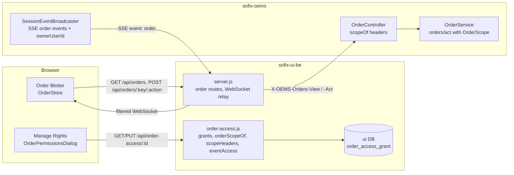
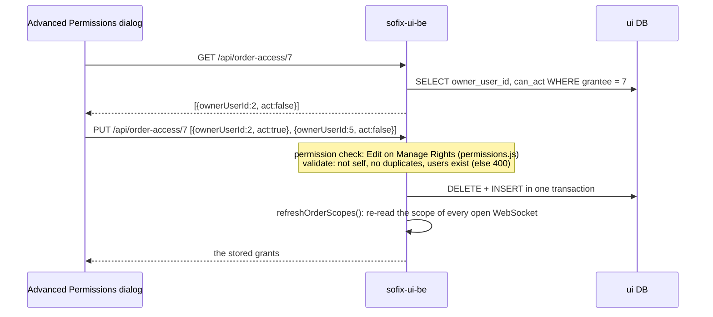

# Feature: who sees and acts on which orders

Status: built 2026-10-11 (sofix-oems `1fd274e`, sofix-ui-be `167c82e` `2f74e83`, sofix-ui-fe
`aeaf9f2` `db942f5`). Design: `docs/design/components-and-data-ownership.md` §3.

## 1. Rules

| Who | Sees | Acts on (sends ExecutionReports) |
|---|---|---|
| A user | their own orders | their own orders |
| An administrator (a role with all access) | every order | every order |
| A user with grants | + the orders of the users granted **View** or **Act** | + the orders of the users granted **Act** |
| Orders without a user ("User details missing") | administrators only | administrators only |

Act includes View. Grants are set per user (not per role or group) in Manage Rights → Order
Blotter row → **Advanced Permissions**. Changing them needs Edit on Manage Rights.

## 2. Components and where the data lives



| Data | Owner | Where |
|---|---|---|
| Grants (grantee, owner, can_act) | sofix-ui-be | `ui` DB, table `order_access_grant` (row = View, `can_act` = Act; PK grantee+owner; both cascade on user delete; grantee ≠ owner) |
| Who is an administrator | sofix-ui-be | roles (`app_role.all_access`) via user and group links |
| Order → user (`ownerUserId`, `owner` username) | sofix-oems | in memory on each `Order` (set when the order is attributed by the identity tag) |
| A caller's scope | computed per request | never stored; `orderScopeOf(userId)` in the BFF |

## 3. Data flows

### 3.1 An admin sets grants



### 3.2 The blotter loads and the user acts

```mermaid
sequenceDiagram
  participant UI as Order Blotter (user 7)
  participant BE as sofix-ui-be
  participant O as sofix-oems
  UI->>BE: GET /api/orders
  BE->>BE: orderScopeOf(7) → view {7,2,5}, act {7,2}
  BE->>O: GET /api/orders  X-OEMS-Orders-View: 7,2,5  X-OEMS-Orders-Act: 7,2
  O-->>UI: orders of 7, 2, 5; those of 5 with actions = []
  UI->>BE: POST /api/orders/12/ack (order of user 5)
  BE->>O: same, with the scope headers
  O-->>UI: 403 OEMS-ORD-0005 "You may view this order but not act on it." (nothing sent)
```

Administrators send `all` in both headers.

### 3.3 Live order events

1. sofix-oems publishes every order message on its SSE stream with `ownerUserId`.
2. sofix-ui-be parses `ownerUserId` once and, per open WebSocket, calls
   `eventAccess(client.orderScope, ownerUserId)`:
   `act` → the event as sent; `view` → the event with `actions: []`; `null` → not sent.
3. The blotter keeps the actions per order; a live order with no actions is shown as
   "View only" in its right-click menu.

A socket's scope is read when it opens, and again after grants, users, roles or groups change.

## 4. Where each rule is enforced

| Rule | Enforced in | Test |
|---|---|---|
| Filter list / refuse action | sofix-oems `OrderService.orders(scope)`, `act(…, scope)` | `OrderServiceTest`, `OrderApiTest` |
| Header parsing | sofix-oems `OrderController.scopeOf` | `OrderControllerScopeTest` |
| Scope from grants and roles | sofix-ui-be `orderScopeOf` | throwaway-backend check (manual, 2026-10-11) |
| Event filtering | sofix-ui-be `eventAccess`, `onOrderEvent` | same check |
| Who may change grants | sofix-ui-be `permissions.js` (`/api/order-access` → Manage Rights) | same check |
| Menu shows "View only" | sofix-ui-fe `OrderBlotter.viewOnly` | not covered by a spec |

## 5. Known limitations and gaps

1. **The scope is not signed.** sofix-oems trusts the `X-OEMS-Orders-*` headers. The design
   (components-and-data-ownership §3) asks for a signed token carrying the user's id, groups and
   roles, verified by the OEMS. Until then anyone who can reach port 8095 can claim any scope.
2. **No headers = every order.** A request without both headers sees and acts on all orders (kept
   so `curl` on the OEMS host works). The browser cannot set them: the BFF forwards only
   `content-type` and `x-file-name` from the browser, and always adds the scope.
3. **Grant changes are not audited** (who granted what, when). The design lists a
   `ui_audit_log`; not built yet.
4. **An open blotter does not reload on a grant change.** Live events follow the new scope at
   once; orders already on screen (or missing from it) change only on the next reload.
5. **Grants are per user only**, not per group or role (`user_visibility_scope` in
   `database-tables.md` planned "team X" too).
6. Orders live in sofix-oems memory, so an order's user is gone after a restart, along with the
   order.

## 6. How to try it

1. As an admin: Manage Rights → choose user A → click the Order Blotter row → Advanced
   Permissions → tick View for user B, Act for user C → Save.
2. Sign in as A: the blotter shows A's, B's and C's orders; right-click one of B's: "View only".
3. Without the UI:

```bash
curl -H 'X-OEMS-Orders-View: 2' -H 'X-OEMS-Orders-Act:' localhost:8095/api/orders
curl -X POST -H 'X-OEMS-Orders-View: 2' -H 'X-OEMS-Orders-Act:' localhost:8095/api/orders/1/ack   # 403
```
